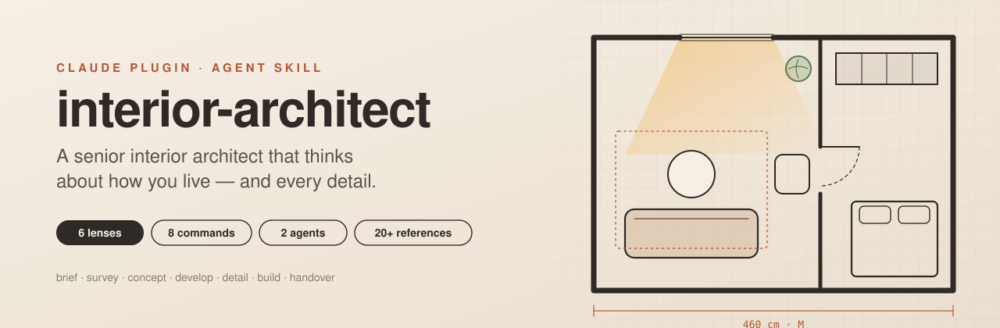
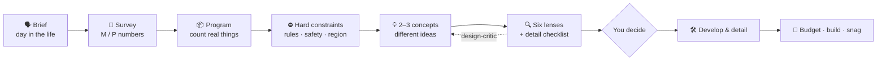

<div align="center">



<br/>

[](CHANGELOG.md)
[](#-install)
[](skills/interior-architect/SKILL.md)
[](LICENSE)
[](LICENSE-CONTENT.md)
[](README.tr.md)

**Turn Claude into a senior interior architect for your own home.**<br/>
It asks how you live, insists on real measurements, invents 2–3 genuinely different concepts,<br/>
and checks every idea — down to the light switch behind the door — before anyone builds it.

[Install](#-install) · [What it does](#-what-it-does) · [Commands](#-slash-commands) · [How it thinks](#-how-it-thinks) · [Knowledge base](#-knowledge-base) · [Türkçe](README.tr.md)

</div>

---

> [!WARNING]
> **Not a substitute for a licensed professional.** Gas, electrical and structural work is decided by licensed installers and local authorities. Code numbers in this skill may be outdated; always verify the current edition.

## ✨ What it does

| | |
|---|---|
| 🗣️ **Interviews like a pro** | Starts with *a day in your life* — morning rush, coming home, evening, night, weekend — and turns every pause or complaint into a requirement. |
| 📏 **Surveys before drawing** | Gives a tailored measuring list and survey sheet. Every number is marked **M** (measured) or **P** (from plan). No guessing. |
| 💡 **Invents, then tests** | 2–3 concepts built on *different organizing ideas* (flip the constraint, time-based zoning, thicken the wall, room-within-a-room, borrow light…), one reasoned recommendation, plus its own optional ideas. |
| 🔍 **Sweats the details** | A 40+ point pre-flight checklist: door swings vs. switches, sockets inside cabinets, tile set-out, filler strips, curtain stack-back, access hatches, where the bins and the robot vacuum go. |
| 🌿 **Designs for wellbeing** | Biophilic patterns, prospect & refuge, curvature, circadian lighting, acoustics (RT60 / STC), air quality and healthy materials — explained in plain words. |
| 🏷️ **Honest numbers** | Every figure tagged **V** (guideline / research / maker), **R** (regulation) or **G** (rule of thumb), with sources. |
| 🧠 **Learns your house rules** | Correct it once ("no drawers!") and it writes the rule to *your* private `house-rules.md` and keeps a design log. |
| 🎛️ **Interactive configurators** | When one variable decides the design (height, depth, gap), it builds a slider tool instead of guessing. |
| 🧾 **Takes you to handover** | Budget sheet with contingency, order of works, lead times, quote comparison, site checks and a snag list. |

## 🚀 Install

**Claude Code (plugin — recommended)** — type these in the Claude Code prompt (they are slash commands, not shell commands):

```text
/plugin marketplace add yunusemre-senturk/interior-architect
/plugin install interior-architect@interior-architect
```

From a shell, the same with the `claude` CLI:

```bash
claude plugin marketplace add yunusemre-senturk/interior-architect && claude plugin install interior-architect@interior-architect
```

<details>
<summary>Or add it to <code>~/.claude/settings.json</code> (installs on the next session)</summary>

```json
{
  "extraKnownMarketplaces": {
    "interior-architect": {
      "source": { "source": "github", "repo": "yunusemre-senturk/interior-architect" }
    }
  },
  "enabledPlugins": { "interior-architect@interior-architect": true }
}
```
</details>

**Claude Code (skill only)** — copy `skills/interior-architect/` to `~/.claude/skills/` (personal) or `.claude/skills/` (project).

**claude.ai** — zip the `skills/interior-architect/` folder and upload it as a custom skill in your settings.

**Other agents** (Codex, Cursor, …) — place the folder wherever your agent loads Agent Skills.

## ⌨️ Slash commands

| Command | What it does |
|---|---|
| `/interior-architect:brief [room]` | Discovery interview → a confirmed one-page design brief |
| `/interior-architect:survey [room]` | Tailored measuring list + survey sheet for your phone |
| `/interior-architect:concept [room + facts]` | 2–3 inventive concepts, comparison table, one recommendation |
| `/interior-architect:review [plan / photo]` | Ranked senior-level critique (blocker → opportunity) |
| `/interior-architect:palette [room + style]` | Colour, material and finish palette with maintenance notes |
| `/interior-architect:budget [scope]` | Budget sheet, contingency, order of works, lead times |
| `/interior-architect:research [problem]` | Built precedents, products and current guidance from the web |
| `/interior-architect:snag [room]` | Handover inspection list and documents to collect |

Or just talk to Claude — the skill triggers on its own for any interior design question.

## 🤖 Agents

| Agent | Role |
|---|---|
| **`design-critic`** | A sceptical senior colleague with fresh eyes. Reviews a concept against constraints, safety, ergonomics, the detail checklist, light, acoustics and aesthetics, and returns a ranked list of fixes. |
| **`precedent-researcher`** | Finds built precedents, product dimensions and current guidance on the web (uses Firecrawl when available) and distils them into design moves. |

## 🧭 How it thinks



### The six lenses

| # | Lens | Checks |
|---|---|---|
| 1 | **Use & flow** | Every item has a home, drop-off moments, door/drawer conflicts, cleaning and service access |
| 2 | **Ergonomics** | Clearances for the largest user, reach for the smallest, comfortable / tight / never-below bands |
| 3 | **Aesthetics** | Proportion, rhythm, alignment, 2–3 materials + accent, 60-30-10 colour, scale |
| 4 | **Systems & safety** | Gas, electrical zones, ventilation, anchoring (seismic!), children, older users, licensed trades |
| 5 | **Light** | Ambient / task / accent layers, lux targets, glare, daylight, circadian timing |
| 6 | **Wellbeing** | Biophilia, prospect & refuge, acoustics, air quality, thermal comfort, healthy materials |

## 💬 Example

> **You:** Our 2+1 living room feels cramped and dark. Can you redesign it?
>
> **Claude:** Before drawing, three quick questions: who uses the room in the evening and for what (TV, work, kids' play)? Which wall has the window, and is there a radiator under it? Roughly how many metres of books and how many board games need a home? …
>
> *…then:* three concepts — **A · Subtract** (remove the low cabinet wall and float the sofa), **B · Thicken one wall** (a 40 cm full-height storage wall that hides the TV), **C · Borrow light** (mirror + pale rug + curtains to the ceiling) — a recommendation, three optional ideas, and a list of what to measure on site.

## 📚 Knowledge base

<details>
<summary><b>20+ reference files, loaded only when needed</b></summary>

| Area | Files |
|---|---|
| Process | `design-process.md` (RIBA / AIA / TR İçmimarlar Odası stages) · `discovery-brief.md` · `project-delivery.md` |
| Creativity & rigour | `innovation-playbook.md` · `detail-checklist.md` |
| Rooms | `kitchen.md` · `bathroom.md` · `laundry.md` · `entry-wardrobe.md` · `living-bedroom.md` · `home-office-small-spaces.md` · `stairs.md` |
| People | `accessibility-family.md` (ageing in place, wheelchair, children, pets) |
| Senses | `lighting.md` · `wellbeing.md` · `acoustics.md` · `aesthetics.md` · `furnishing-styling.md` |
| Building | `materials.md` · `sustainability.md` · `systems-safety.md` · `survey-checklist.md` |
| Regions | `regions/tr.md` · `us.md` · `uk.md` · `eu.md` |
| Sources | `sources.md` — every number traced to NKBA, IES, OSHA, WELL, CPSC, Terrapin, RIBA, TMMOB, peer-reviewed research and more |

Templates in `assets/`: house rules, design log, survey sheet, brief questionnaire, concept board, budget sheet, snag list, configurator.

</details>

## 🔒 Your private files

The skill looks for, in this order: a claude.ai Project doc `house-rules.md`; `.interior-architect/house-rules.md` in your working folder. Start from [`assets/house-rules.template.md`](skills/interior-architect/assets/house-rules.template.md). These files are git-ignored here and should never be published.

## 🌍 Regions

| Code | Status |
|---|---|
| 🇹🇷 `tr` Türkiye | **full** — sources checked 2026-11 (İmar Yönetmeliği incl. stairs, İGDAŞ, TMMOB İçmimarlar Odası, earthquake) |
| 🇺🇸 `us` United States | skeleton, unverified |
| 🇬🇧 `uk` United Kingdom | skeleton, unverified |
| 🇪🇺 `eu` EU general | skeleton, pointer only |

Help wanted — see [CONTRIBUTING.md](CONTRIBUTING.md).

## 🗂️ Repository layout

```
.claude-plugin/            plugin + marketplace manifests
agents/                    design-critic, precedent-researcher
commands/                  brief, survey, concept, review, palette, budget, research, snag
skills/interior-architect/
  SKILL.md                 workflow, six lenses, rules (loaded when triggered)
  references/              rooms, process, wellbeing, acoustics, details, sources …
  references/regions/      country rules (only the user's country is read)
  assets/                  templates, survey sheet, configurator
evals/scenarios.md         18 test prompts with pass/fail checks
```

## 🧪 Quality

[`evals/scenarios.md`](evals/scenarios.md) holds 18 scenarios (kitchens, laundry stacking, accessibility, child safety, circadian light, acoustics, budgets, review of a flawed plan …) with *must do* and *red flag* checks, plus a privacy check to run before each release.

## 🛣️ Roadmap

- [ ] Verified `us`, `uk` and `de` region files
- [ ] More configurators (kitchen aisle, wardrobe interior, stair calculator)
- [ ] SVG plan generator from survey sheets
- [ ] Automated eval runner

## 🤝 Contributing

Contributions are welcome — especially region files and verified numbers. Read [CONTRIBUTING.md](CONTRIBUTING.md) first: no personal data, tag every number, never copy guideline text.

## 📄 License

Text and reference content: [CC BY 4.0](LICENSE-CONTENT.md). Code (configurator, scripts): [MIT](LICENSE). Guideline numbers are cited facts; no guideline text is reproduced.

<div align="center"><sub>Made with care for people who live in their homes, not just look at them.</sub></div>
