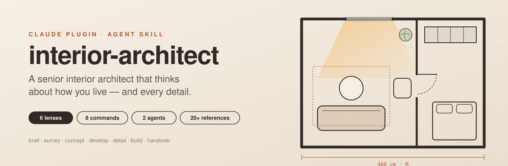
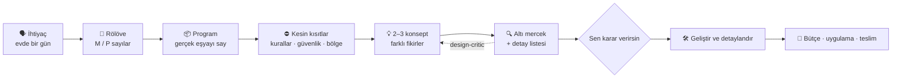

<div align="center">



<br/>

[](CHANGELOG.md)
[](#-kurulum)
[](skills/interior-architect/SKILL.md)
[](LICENSE)
[](LICENSE-CONTENT.md)
[](README.md)

**Claude'u kendi evin için kıdemli bir iç mimara dönüştür.**<br/>
Önce nasıl yaşadığını sorar, gerçek ölçü ister, birbirinden gerçekten farklı 2–3 konsept üretir<br/>
ve her fikri — kapının arkasında kalan lamba anahtarına kadar — uygulanmadan önce kontrol eder.

[Kurulum](#-kurulum) · [Ne yapar](#-ne-yapar) · [Komutlar](#️-slash-komutları) · [Nasıl düşünür](#-nasıl-düşünür) · [Bilgi tabanı](#-bilgi-tabanı) · [English](README.md)

</div>

---

> [!WARNING]
> **Yetkili bir profesyonelin yerine geçmez.** Gaz, elektrik ve taşıyıcı sistem işlerine yetkili tesisatçı ve yerel idare karar verir. Bu dosyalardaki yönetmelik sayıları güncelliğini yitirmiş olabilir; yürürlükteki sürümü mutlaka kontrol et.

## ✨ Ne yapar

| | |
|---|---|
| 🗣️ **Profesyonel gibi dinler** | *Evde bir günün*den başlar: sabah telaşı, eve dönüş, akşam, gece, hafta sonu. Her duraksamayı ve şikâyeti bir ihtiyaca çevirir. |
| 📏 **Çizimden önce rölöve** | Odaya özel ölçü listesi ve ölçü formu verir. Her sayı **M** (ölçüldü) ya da **P** (plandan) diye işaretlenir. Tahmin yok. |
| 💡 **Önce icat eder, sonra sınar** | *Farklı ana fikirlere* dayanan 2–3 konsept (kısıtı tersine çevir, zamana göre bölgele, duvarı kalınlaştır, oda içinde oda, ışık ödünç al…), gerekçeli tek öneri ve kendi opsiyonel fikirleri. |
| 🔍 **Detayları atlamaz** | 40+ maddelik ön kontrol: kapı açılımı ve anahtar, dolap içi priz, fayans aksı, dolgu profili, perde toplanma payı, servis kapakları, çöp kovası ve robot süpürgenin yeri. |
| 🌿 **İyi oluş için tasarlar** | Biyofilik desenler, görüş ve sığınak, kavisli formlar, sirkadiyen aydınlatma, akustik (RT60 / STC), hava kalitesi ve sağlıklı malzeme — sade bir dille. |
| 🏷️ **Dürüst sayılar** | Her sayı etiketli: **V** (kılavuz / araştırma / üretici), **R** (yönetmelik), **G** (genel uygulama), kaynaklarıyla. |
| 🧠 **Ev kurallarını öğrenir** | Bir kez düzelt ("çekmece istemiyorum!"), kuralı senin özel `house-rules.md` dosyana yazar ve karar günlüğü tutar. |
| 🎛️ **Etkileşimli araçlar** | Tasarım tek bir değişkene bağlıysa (yükseklik, derinlik, boşluk) tahmin yerine kaydırıcılı bir araç kurar. |
| 🧾 **Teslime kadar götürür** | Yedek paylı bütçe tablosu, iş sırası, tedarik süreleri, teklif karşılaştırma, şantiye kontrolleri ve teslim (snag) listesi. |

## 🚀 Kurulum

**Claude Code (plugin — önerilen)** — bunları Claude Code'un sohbet kutusuna yaz (bunlar slash komutu, terminal komutu değil):

```text
/plugin marketplace add yunusemre-senturk/interior-architect
/plugin install interior-architect@interior-architect
```

Terminalden, `claude` CLI ile aynısı:

```bash
claude plugin marketplace add yunusemre-senturk/interior-architect && claude plugin install interior-architect@interior-architect
```

<details>
<summary>Ya da <code>~/.claude/settings.json</code> dosyasına ekle (sonraki oturumda kurulur)</summary>

```json
{
  "extraKnownMarketplaces": {
    "interior-architect": {
      "source": { "source": "github", "repo": "yunusemre-senturk/interior-architect" }
    }
  },
  "enabledPlugins": { "interior-architect@interior-architect": true }
}
```
</details>

**Claude Code (yalnız skill)** — `skills/interior-architect/` klasörünü `~/.claude/skills/` (kişisel) ya da `.claude/skills/` (proje) altına kopyala.

**claude.ai** — `skills/interior-architect/` klasörünü zip'le ve ayarlardan özel skill olarak yükle.

**Diğer ajanlar** (Codex, Cursor, …) — klasörü ajanının Agent Skill yüklediği yere koy.

## ⌨️ Slash komutları

| Komut | Ne yapar |
|---|---|
| `/interior-architect:brief [oda]` | Keşif görüşmesi → onaylanmış tek sayfalık tasarım özeti |
| `/interior-architect:survey [oda]` | Odaya özel ölçü listesi + telefonda doldurulacak rölöve formu |
| `/interior-architect:concept [oda + bilgiler]` | 2–3 yaratıcı konsept, karşılaştırma tablosu, tek öneri |
| `/interior-architect:review [plan / foto]` | Kıdemli gözle sıralı eleştiri (engel → fırsat) |
| `/interior-architect:palette [oda + stil]` | Renk, malzeme ve yüzey paleti, bakım notlarıyla |
| `/interior-architect:budget [kapsam]` | Bütçe tablosu, yedek pay, iş sırası, tedarik süreleri |
| `/interior-architect:research [problem]` | Webden uygulanmış örnekler, ürünler ve güncel kurallar |
| `/interior-architect:snag [oda]` | Teslim kontrol listesi ve alınacak belgeler |

Ya da Claude ile doğrudan konuş — skill, iç mimari ile ilgili her soruda kendiliğinden devreye girer.

## 🤖 Ajanlar

| Ajan | Görevi |
|---|---|
| **`design-critic`** | Taze gözle bakan şüpheci kıdemli meslektaş. Konsepti kısıtlar, güvenlik, ergonomi, detay listesi, ışık, akustik ve estetik açısından inceler; sıralı düzeltme listesi döner. |
| **`precedent-researcher`** | Webde uygulanmış örnekleri, ürün ölçülerini ve güncel kuralları bulur (varsa Firecrawl kullanır) ve tasarım hamlelerine dönüştürür. |

## 🧭 Nasıl düşünür



### Altı mercek

| # | Mercek | Neye bakar |
|---|---|---|
| 1 | **Kullanım ve akış** | Her eşyanın yeri, eve giriş anı, kapı/çekmece çakışmaları, temizlik ve servis erişimi |
| 2 | **Ergonomi** | En iri kullanıcıya göre boşluk, en kısaya göre erişim; rahat / sıkışık / asla altı bantları |
| 3 | **Estetik** | Oran, ritim, hizalama, 2–3 malzeme + vurgu, 60-30-10 renk, ölçek |
| 4 | **Tesisat ve güvenlik** | Gaz, elektrik bölgeleri, havalandırma, sabitleme (deprem!), çocuk, yaşlı, yetkili ustalar |
| 5 | **Işık** | Genel / görev / vurgu katmanları, lüks hedefleri, kamaşma, gün ışığı, sirkadiyen zamanlama |
| 6 | **İyi oluş** | Biyofili, görüş ve sığınak, akustik, hava kalitesi, ısıl konfor, sağlıklı malzeme |

## 💬 Örnek

> **Sen:** 2+1 salonumuz sıkışık ve karanlık. Yeniden tasarlar mısın?
>
> **Claude:** Çizmeden önce üç kısa soru: Akşamları salonu kim, ne için kullanıyor (TV, çalışma, çocuk oyunu)? Pencere hangi duvarda, altında petek var mı? Kaç metre kitap ve kaç kutu oyun yer istiyor? …
>
> *…ardından:* üç konsept — **A · Çıkar** (alçak dolap duvarını kaldır, koltuğu ortaya al), **B · Bir duvarı kalınlaştır** (TV'yi saklayan 40 cm derin, tavana kadar depolama duvarı), **C · Işık ödünç al** (ayna + açık renk halı + tavandan perde) — bir öneri, üç opsiyonel fikir ve yerinde ölçülecekler listesi.

## 📚 Bilgi tabanı

<details>
<summary><b>Yalnız gerektiğinde okunan 20+ referans dosyası</b></summary>

| Alan | Dosyalar |
|---|---|
| Süreç | `design-process.md` (RIBA / AIA / TMMOB İçmimarlar Odası aşamaları) · `discovery-brief.md` · `project-delivery.md` |
| Yaratıcılık ve titizlik | `innovation-playbook.md` · `detail-checklist.md` |
| Mekânlar | `kitchen.md` · `bathroom.md` · `laundry.md` · `entry-wardrobe.md` · `living-bedroom.md` · `home-office-small-spaces.md` · `stairs.md` |
| İnsanlar | `accessibility-family.md` (yerinde yaşlanma, tekerlekli sandalye, çocuk, evcil hayvan) |
| Duyular | `lighting.md` · `wellbeing.md` · `acoustics.md` · `aesthetics.md` · `furnishing-styling.md` |
| Yapı | `materials.md` · `sustainability.md` · `systems-safety.md` · `survey-checklist.md` |
| Bölgeler | `regions/tr.md` · `us.md` · `uk.md` · `eu.md` |
| Kaynaklar | `sources.md` — her sayı NKBA, IES, OSHA, WELL, CPSC, Terrapin, RIBA, TMMOB, hakemli araştırmalar ve daha fazlasına dayanır |

`assets/` içindeki şablonlar: ev kuralları, karar günlüğü, rölöve formu, ihtiyaç anketi, konsept panosu, bütçe tablosu, teslim listesi, konfigüratör.

</details>

## 🔒 Özel dosyaların

Ev kuralların ve karar günlüğün yalnız senin çalışma alanında kalır: bir claude.ai Project dokümanında ya da çalışma klasöründeki `.interior-architect/` içinde. Bu dosyalar bu repoda `.gitignore` ile dışarıda bırakılır. Asla yayınlama.

## 🌍 Bölgeler

| Kod | Durum |
|---|---|
| 🇹🇷 `tr` Türkiye | **tam** — kaynaklar 2026-11'de kontrol edildi (İmar Yönetmeliği ve merdivenler, İGDAŞ, TMMOB İçmimarlar Odası, deprem) |
| 🇺🇸 `us` ABD | iskelet, doğrulanmadı |
| 🇬🇧 `uk` Birleşik Krallık | iskelet, doğrulanmadı |
| 🇪🇺 `eu` AB genel | iskelet, yalnız yönlendirme |

Katkılara açık — [CONTRIBUTING.md](CONTRIBUTING.md).

## 🧪 Kalite

[`evals/scenarios.md`](evals/scenarios.md) 18 senaryo içerir (mutfak, çamaşır makinesi üst üste, erişilebilirlik, çocuk güvenliği, sirkadiyen ışık, akustik, bütçe, hatalı bir planın eleştirisi …) ve her sürümden önce çalıştırılacak bir gizlilik kontrolü.

## 🛣️ Yol haritası

- [ ] Doğrulanmış `us`, `uk` ve `de` bölge dosyaları
- [ ] Yeni konfigüratörler (mutfak koridoru, gardırop içi, merdiven hesabı)
- [ ] Rölöve formundan SVG plan üretici
- [ ] Otomatik eval çalıştırıcı

## 📄 Lisans

Metin ve referans içerik: [CC BY 4.0](LICENSE-CONTENT.md). Kod (konfigüratör, betikler): [MIT](LICENSE). Kılavuz sayıları kaynak gösterilmiş olgulardır; kılavuz metni kopyalanmamıştır.

<div align="center"><sub>Evine yalnızca bakan değil, içinde yaşayan insanlar için özenle yapıldı.</sub></div>
